<p align="center">
  
</p>

Escribes un `flowchart` con sintaxis de Mermaid y obtienes un SVG animado con el estilo ya marcado, listo para ponerlo arriba de tu README. Python puro, sin dependencias.

## Uso

Crea un fichero `docs/hero.mmd`:

```text
---
title: store-sales-forecasting
subtitle: ¿Cuánto venderá mañana un supermercado?
stack: Python · pandas · LightGBM · Kaggle
---
flowchart LR
  A[Idea<br/>45 experimentos]:::cyan --> B[Backtest<br/>4 folds]:::cyan
  B --> C[Holdout<br/>últimos 16 días]:::amber
  C --> D[Kaggle<br/>10 versiones]:::purple
```

Genera el SVG y cárgalo como imagen:

```bash
pip install git+https://github.com/AlbaAsca/flowbanner@v1
flowbanner build docs/hero.mmd
```

```html

```

`flowbanner build --check` falla si algún SVG no está al día, y `-o` elige otra ruta de salida.

## GitHub Action

Regenera y sube los banners cuando cambia un `.mmd`:

```yaml
name: Banners
on:
  push:
    paths: ["docs/**/*.mmd"]
permissions:
  contents: write
jobs:
  banners:
    runs-on: ubuntu-latest
    steps:
      - uses: actions/checkout@v4
      - uses: AlbaAsca/flowbanner@v1
        with:
          files: docs/**/*.mmd
```

Con `commit: "false"` solo genera los ficheros, sin hacer commit.

## Sintaxis

| Elemento | Ejemplo | Notas |
| --- | --- | --- |
| Cabecera | `flowchart LR` o `graph LR` | Solo de izquierda a derecha |
| Nodo | `A[Título<br/>detalle]` | La primera línea es el título; las demás, detalle |
| Texto con símbolos | `A["a < b"]` | Entre comillas |
| Color | `A:::green` | `blue`, `cyan`, `green`, `amber`, `orange`, `red`, `purple` |
| Flecha | `A --> B --> C` | Se pueden encadenar |
| Línea punteada | `A -.-> B` | |
| Etiqueta | `A -->\|SSE\| B` | |
| Comentario | `%% nota` | |

El bloque `---` inicial es opcional. Sin `title`, `subtitle` ni `stack` obtienes solo el diagrama.

| Clave | Para qué sirve |
| --- | --- |
| `title`, `subtitle`, `stack` | Las tres líneas de la cabecera; se encogen si no caben |
| `pulse` | Nodos con pulso animado, separados por comas: `pulse: A, B` |
| `theme` | Tema incluido o ruta a un `.json` |
| `width` | Ancho del lienzo; 1200 por defecto |

Lo que no se admite da un error con el número de línea, en lugar de dibujarse mal.

## Ejemplos

Cada `.svg` se genera con el `.mmd` del mismo nombre en [`examples/`](examples).





## Temas

Copia [`tokyo-night.json`](src/flowbanner/themes/tokyo-night.json), cambia los colores y úsalo con `theme: mi-tema.json` o `--theme mi-tema.json`.

## Limitaciones

- Solo `flowchart LR`: no hay secuencias, subgrafos ni otras formas de nodo.
- La colocación es por columnas y filas. Con muchos cruces, o con flechas que saltan columnas o vuelven atrás, una línea puede pasar por detrás de un nodo.
- El ancho del texto es una estimación, porque quien pinta el SVG es el navegador. Revisa el resultado si usas etiquetas muy largas.
- GitHub solo muestra el SVG como imagen: las animaciones funcionan, pero no se puede usar JavaScript ni enlaces dentro.

## Desarrollo

```bash
pip install -e ".[dev]"
pytest
```

## Licencia

[MIT](LICENSE)
